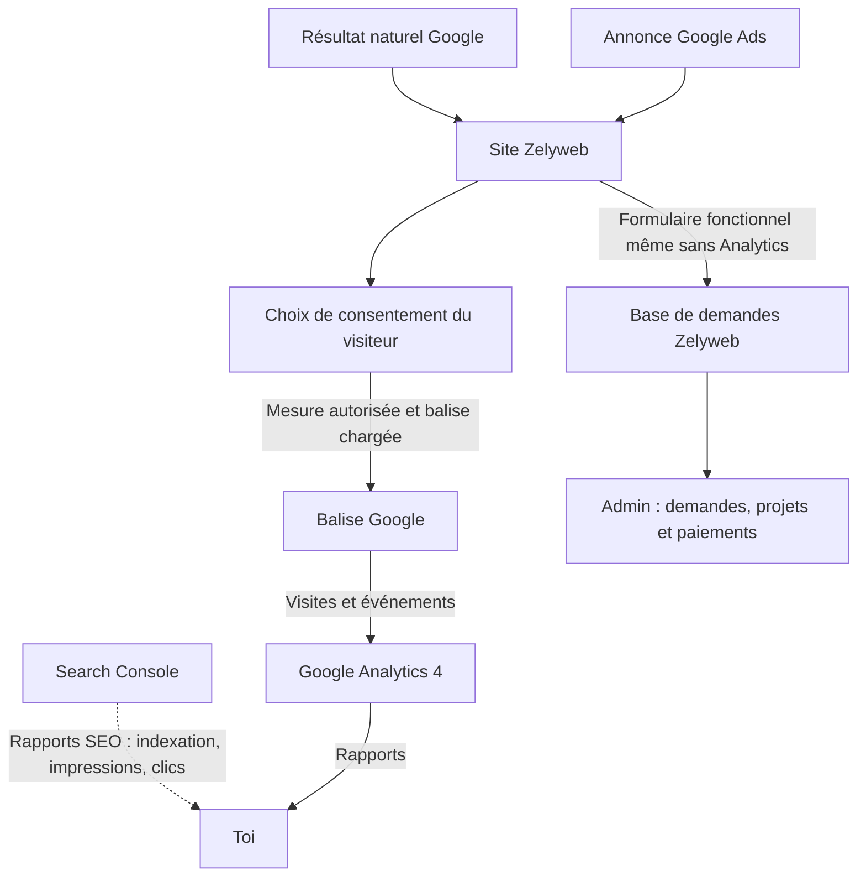
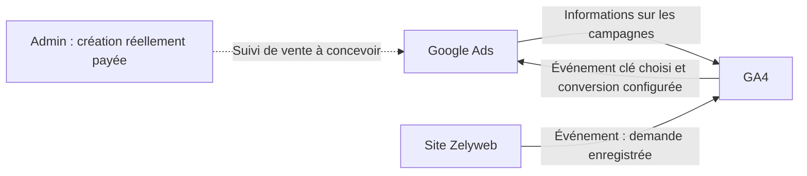
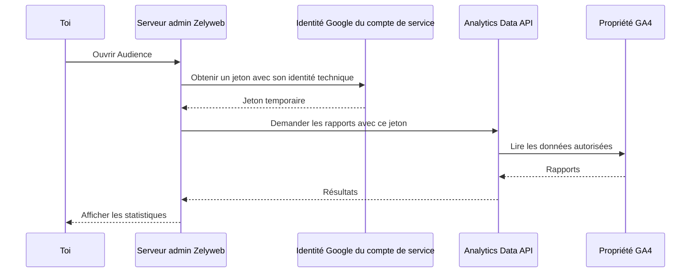
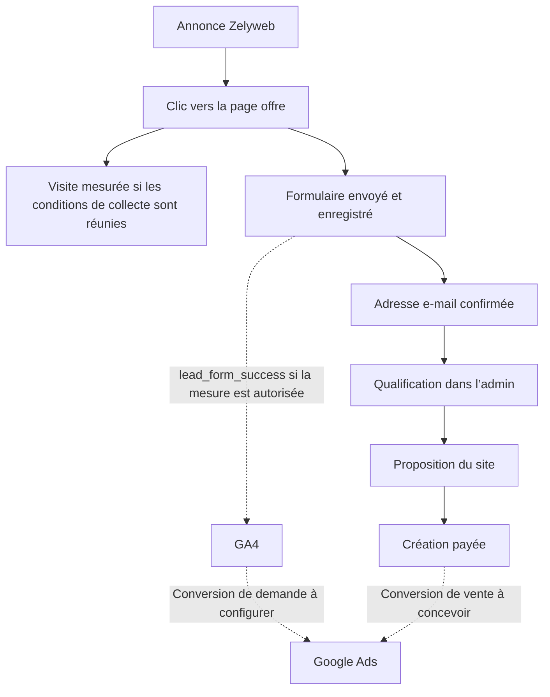

# Comprendre et connecter les services Google pour Zelyweb

Document préparé le 21 octobre 2026, à partir du code du projet et des documentations officielles citées ci-dessous.

## 1. Le rôle de chaque outil

| Service | Question à laquelle il répond | Exemple pour Zelyweb |
| --- | --- | --- |
| Google Search | Où le site apparaît-il dans le moteur ? | Un professionnel recherche une création de site vitrine. |
| Search Console | Comment Google découvre-t-il le site et quelles recherches naturelles lui apportent des clics ? | Vérifier l’indexation et les requêtes SEO. |
| Google Ads | Comment diffuser des annonces payantes et suivre leurs résultats ? | Tester une campagne avec une enveloppe ponctuelle de 150 €. |
| Google Analytics 4, ou GA4 | Que font les visiteurs mesurés sur le site et d’où viennent-ils ? | Mesurer les visites, les clics et les demandes enregistrées. |
| Balise Google, ou Google tag | Comment transmettre des événements depuis le navigateur ? | Envoyer `page_view` et `lead_form_success` vers GA4. |
| Google Tag Manager, ou GTM | Comment gérer les balises et leurs déclenchements dans une interface ? | Installer ou modifier des balises sans modifier chaque fois le code du site. |
| Google Cloud Console | Où gérer les API et les identités techniques ? | Activer l’API Analytics et créer une identité pour l’admin. |
| Google Analytics Data API | Comment un logiciel peut-il lire les rapports GA4 ? | Afficher les chiffres dans la page Audience de l’admin Zelyweb. |
| Admin Zelyweb et PostgreSQL | Quelles demandes et ventes ont réellement été enregistrées ? | Suivre une demande confirmée jusqu’à sa commande payée. |

**Search Console concerne le référencement naturel ; Google Ads concerne la publicité.** Search Console ne nécessite pas GA4 pour fonctionner. Elle fournit des informations sur l’exploration, l’indexation et les performances dans Google Search. [Présentation officielle de Search Console](https://developers.google.com/search/docs/monitor-debug/search-console-start?hl=fr)

GTM est un gestionnaire de balises, pas un outil d’analyse supplémentaire. La balise Google peut être installée directement dans le code, comme dans Zelyweb, sans conteneur GTM. [Présentation de GTM](https://support.google.com/tagmanager/answer/12811173?hl=fr)

## 2. Schéma général : acquisition et mesure



Search Console observe la visibilité dans le moteur. GA4 mesure l’activité sur le site lorsque la collecte est possible. La base métier enregistre les demandes indépendamment d’Analytics.

Exemple : dix demandes peuvent être enregistrées dans l’admin et seulement sept événements correspondants mesurés dans GA4, notamment à cause du consentement ou des bloqueurs. Ce décalage ne prouve pas à lui seul un dysfonctionnement.

## 3. Les connexions sont indépendantes

### A. Site → GA4 : collecter les événements

La balise du navigateur envoie les événements vers un flux Web GA4 identifié par un numéro commençant par `G-`.

Dans Zelyweb, le code prévoit :

- L’identifiant de mesure par défaut `G-TDLF1WPKD4`, remplaçable par `NEXT_PUBLIC_GA_ID`.
- Le chargement après acceptation de la mesure d’audience.
- Des événements de navigation et de formulaire.

**Ce code ne prouve pas que la propriété de ton compte est la bonne ni que les données arrivent sur le site déployé.** Il faut le vérifier dans GA4 et dans le navigateur.

### B. GA4 ↔ Google Ads : relier acquisition et résultats

La liaison des comptes permet de retrouver des données publicitaires dans Analytics et de créer des conversions Ads à partir d’événements clés GA4. Elle ne crée pas les événements manquants sur le site et ne transforme pas automatiquement une demande en vente. [Liaison GA4 et Google Ads](https://support.google.com/analytics/answer/9379420?hl=fr)



La flèche en pointillés représente une connexion future : aucun import automatique des ventes depuis l’admin vers Ads n’a été confirmé.

Deux approches de mesure publicitaire sont possibles : créer une conversion à partir de GA4, ou utiliser une mesure Google Ads dédiée. Pour un même objectif, il faut éviter de compter les deux comme deux conversions principales distinctes.

### C. Search Console ↔ GA4 : rapprocher SEO et comportement

Cette liaison facultative ajoute dans Analytics des rapports sur les requêtes naturelles et les pages d’entrée. Elle relie une propriété Search Console au flux Web correspondant. Les données restent agrégées : on ne récupère pas le mot-clé personnel de chaque visiteur. [Connexion Search Console et GA4](https://support.google.com/analytics/answer/10737381?hl=fr)

Elle ne remplace pas la liaison Google Ads et ne rend pas le site mieux classé par elle-même.

### D. GA4 → API → admin : afficher les statistiques chez toi

Une API est une interface permettant à un logiciel de communiquer avec un autre. Dans ce cas, l’admin demande à Google de lui retourner des rapports Analytics.



Le compte de service est l’identité d’un programme. Il doit être autorisé à lire la propriété GA4 ; activer l’API dans Google Cloud ne suffit pas à donner cet accès. Le guide officiel décrit cette authentification et les demandes de rapports. [Démarrage Analytics Data API](https://developers.google.com/analytics/devguides/reporting/data/v1/quickstart)

**Cette API lit les rapports ; elle n’installe pas la balise et ne collecte pas les visites.** Elle n’est pas nécessaire pour consulter GA4 directement ni pour lancer une campagne Ads.

## 4. Search Console et Cloud Console : deux consoles différentes

- **Search Console** : référencement, indexation, recherches et sitemap du site.
- **Google Cloud Console** : projets techniques, API, identités et autorisations Cloud.
- **Console d’administration GA4** : propriété Analytics, flux Web, utilisateurs et liaisons produit.
- **Interface Google Ads** : campagnes, annonces, dépenses, facturation et conversions publicitaires.

Un même compte Google peut accéder à ces interfaces, mais les autorisations restent distinctes. Être administrateur d’un projet Cloud ne donne pas automatiquement accès aux rapports d’une propriété GA4.

## 5. Les identifiants à ne pas confondre

| Identifiant | Exemple ou forme | Utilisation | Secret ? |
| --- | --- | --- | --- |
| ID de mesure GA4 | `G-TDLF1WPKD4` dans le code | Envoyer les événements vers le flux Web | Non |
| ID de propriété GA4 | `559264383` dans le projet | Désigner la propriété pour les rapports et l’API | Non |
| ID de compte Google Ads | Souvent `123-456-7890` | Identifier le compte publicitaire | Ce n’est pas un mot de passe |
| ID publicitaire de balise | `AW-…` | Destination Google Ads selon la configuration retenue | Non |
| ID de conteneur GTM | `GTM-…` | Charger un conteneur Tag Manager | Non |
| Propriété Search Console | Domaine ou préfixe d’URL | Définir le périmètre du site vérifié | Non |
| Adresse de compte de service | `…@….iam.gserviceaccount.com` | Identifier le programme autorisé | Pas une clé privée |
| Clé privée du compte de service | Champ `private_key` du JSON | Authentifier le serveur admin | **Oui** |

Les deux identifiants GA4 présents dans le projet doivent être vérifiés dans ton compte : le dépôt ne permet pas de certifier qu’ils correspondent au même flux et à la propriété que tu possèdes.

La clé privée doit rester côté serveur, hors du dépôt et hors de la conversation. Aucun secret ne doit être placé dans une variable `NEXT_PUBLIC_`.

## 6. Événement, demande et vente : trois niveaux

| Action | Ce qu’elle signifie | Ce qu’elle ne prouve pas |
| --- | --- | --- |
| `page_view` | Une page a été mesurée | Un prospect intéressé |
| `cta_click` | Un bouton suivi a été cliqué | Une demande envoyée |
| `lead_form_start` | Le formulaire a été commencé | Une demande complète |
| `lead_form_submit` | Une tentative d’envoi a été suivie | Un enregistrement réussi |
| `lead_form_success` | Le serveur a confirmé l’enregistrement | Une adresse confirmée ou une vente |
| Prospect qualifié dans l’admin | Demande jugée pertinente | Paiement réalisé |
| Création payée | Paiement de création confirmé | Rentabilité totale de la campagne |

Dans GA4, un événement important peut être désigné comme **événement clé**. Dans Google Ads, une action choisie pour le suivi publicitaire est une **conversion**. La liaison des comptes permet de créer certaines conversions à partir de GA4. [Fonctions de la liaison GA4 et Ads](https://support.google.com/google-ads/answer/7519537?hl=fr)

Pour le premier test Zelyweb, la demande enregistrée est un signal intermédiaire utile. La création payée reste l’objectif commercial. Les clics de boutons ne doivent pas remplacer cet objectif.

## 7. Parcours concret d’un prospect



Le parcours métier fonctionne indépendamment du consentement Analytics. La mesure publicitaire doit être conçue et testée séparément.

## 8. UTM, GCLID et attribution

Les **UTM** décrivent la provenance d’une campagne dans l’URL, par exemple :

```text
https://zelyweb.com/notre-offre?utm_source=google&utm_medium=cpc&utm_campaign=test-site-vitrine
```

Ils permettent de regrouper les visites par source, support et campagne. Ils ne suffisent pas à prouver qu’une vente précise provient d’un clic publicitaire.

Le **GCLID** est un identifiant de clic ajouté par le taggage automatique Google Ads. Il permet notamment de relier un clic à certaines données publicitaires et peut intervenir dans le suivi des conversions. Son traitement doit être vérifié avec les balises et le consentement. [Définition officielle du GCLID](https://support.google.com/google-ads/answer/9744275?hl=fr)

**Point relevé dans le code Zelyweb :** `analyticsLocation()` ne conserve que certains UTM et écarte les autres paramètres de l’URL envoyée en `page_location`, notamment `gclid`. Cela ne permet pas de conclure à lui seul que toute attribution est impossible, car la balise peut aussi lire d’autres informations du navigateur. En revanche, il faut tester le parcours complet avant de déclarer la mesure publicitaire fonctionnelle. Google recommande de vérifier les paramètres de clic et leur conservation pendant les redirections. [Dépannage de l’attribution Ads et GA4](https://support.google.com/google-ads/answer/14452452?hl=fr)

Aucun stockage ou import GCLID dédié à la remontée des ventes n’a été identifié dans le périmètre examiné.

## 9. Consentement : ce qui existe et ce qui reste à concevoir

Le code actuel charge Analytics après acceptation de la mesure. Les paramètres publicitaires `ad_storage`, `ad_user_data` et `ad_personalization` restent à `denied` ; Google signals et les signaux de personnalisation publicitaire sont désactivés.

Il ne faut donc pas considérer que le suivi Ads est prêt parce que le bandeau Analytics existe. Il faudra choisir les usages souhaités, adapter la gestion du consentement si nécessaire et vérifier les signaux transmis. **Ne pas passer automatiquement tous les consentements publicitaires à `granted` lorsqu’un visiteur accepte uniquement l’audience.**

Consent Mode communique les choix aux balises ; il ne fournit pas lui-même un bandeau de consentement. [Fonctionnement de Consent Mode](https://support.google.com/tagmanager/answer/10000067?hl=fr)

## 10. État connu du projet

| Connexion ou fonction | État connu |
| --- | --- |
| Balise GA4 sur le site | Prévue dans le code ; collecte en production et propriété à vérifier |
| Événements de formulaire | Prévus dans le code ; réception réelle à vérifier |
| Rapports GA4 dans l’admin | Lecture API prévue ; identifiants, permissions et résultat en production à vérifier |
| Google Ads ↔ GA4 | L’utilisateur indique que ce n’est pas encore configuré |
| Conversions publicitaires | Non validées pendant cet échange |
| Search Console | Vérification du domaine et liaison GA4 non confirmées |
| GTM | Aucun conteneur utilisé par le mécanisme de mesure examiné ; installation directe de la balise |
| Ventes admin → Ads | Pas d’intégration automatique confirmée |
| E-mails de proposition | Incident `DELIVERY_FAILED` encore à diagnostiquer avant activation de la campagne |

Le chargement de `gtag.js` depuis le domaine `googletagmanager.com` ne signifie pas qu’un conteneur GTM a été installé.

## 11. Configuration recommandée pour le test à 150 €

### Étape 1 — Vérifier la collecte GA4

- [ ] Retrouver la propriété GA4 Zelyweb dans le compte Google.
- [ ] Vérifier que le flux Web correspond à `https://zelyweb.com`.
- [ ] Comparer son ID de mesure au `G-…` utilisé par le site déployé.
- [ ] Accepter la mesure sur un navigateur de test et vérifier la visite.
- [ ] Soumettre une demande test et vérifier `lead_form_success` sans comptage en double.
- [ ] Vérifier qu’un refus de mesure n’empêche pas l’envoi de la demande.

### Étape 2 — Relier Google Ads et GA4

- [ ] Vérifier que le compte Ads est bien destiné à Zelyweb ; conserver les anciennes campagnes arrêtées.
- [ ] Examiner les anciennes conversions avant de sélectionner les objectifs de la nouvelle campagne.
- [ ] Créer la liaison avec la bonne propriété GA4, avec les autorisations nécessaires.
- [ ] Vérifier le taggage automatique, le consentement et le traitement des identifiants de clic.
- [ ] Configurer la conversion de demande, puis tester sa réception.
- [ ] Éviter les doublons entre import GA4 et mesure Ads dédiée.

### Étape 3 — Organiser le suivi commercial

- [ ] Suivre les demandes qualifiées et les créations payées dans l’admin.
- [ ] Pour ce premier test, tenir un bilan manuel des dépenses, demandes et ventes si l’import automatique n’est pas prêt.
- [ ] Ne pas attribuer une vente à Ads sur la seule base d’une proximité de dates.
- [ ] Définir ultérieurement une remontée automatisée fiable si elle devient utile.

### Étape 4 — Préparer le SEO et le confort de lecture

- [ ] Valider la propriété du domaine dans Search Console et soumettre le sitemap.
- [ ] Relier Search Console à GA4 si le regroupement des rapports est souhaité.
- [ ] Configurer le compte de service et la Data API uniquement pour lire GA4 dans l’admin.
- [ ] Conserver l’installation directe de la balise tant qu’un besoin concret ne justifie pas GTM.

Search Console et l’API de lecture dans l’admin ne sont pas des prérequis au lancement d’Ads. Pour ce test, prioriser la fiabilité du parcours client, la mesure des demandes et le contrôle de l’enveloppe ponctuelle de 150 €.

## 12. Où regarder les résultats

| Besoin | Outil à ouvrir |
| --- | --- |
| Dépenses et clics publicitaires | Google Ads |
| Pages consultées et sources mesurées | GA4 |
| Requêtes naturelles et indexation | Search Console |
| Demandes, qualification, commandes payées | Admin Zelyweb |
| Problème d’autorisation de lecture des rapports | Accès à la propriété GA4 et configuration du compte de service Cloud |
| Problème de collecte depuis le navigateur | Balise, événements, consentement et outils de diagnostic |

Les clics Ads, les sessions GA4 et les demandes en base sont des mesures différentes. Ils ne doivent pas nécessairement être égaux. [Différences entre clics et sessions](https://support.google.com/google-ads/answer/14452452?hl=fr)

## 13. Prochaines informations à relever

1. Nom et ID de la propriété GA4 Zelyweb.
2. ID de mesure du flux Web et URL du flux.
3. Présence ou absence d’une visite test dans GA4.
4. État de la page Audience de l’admin.
5. Présence ou absence d’une propriété Search Console validée.

Ne pas partager de mot de passe, clé privée ou fichier JSON d’authentification. Les identifiants de propriété et de mesure suffisent pour commencer le diagnostic.

## Fichiers du projet consultés

- [Collecte et événements](../apps/website/lib/analytics.ts)
- [Consentement et chargement de la balise](../apps/website/components/consent.tsx)
- [Lecture des rapports dans l’admin](../apps/admin/lib/audience.ts)
- [Guide de configuration de l’administration](administration.md)
- [Préparation de la campagne Google Ads](campagne-google-ads-zelyweb.md)
